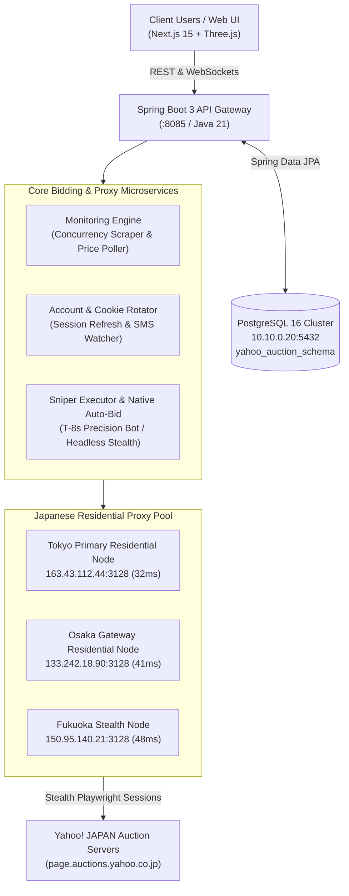

# dashboard_japan_yahoo_auction

A full-stack, enterprise-grade automated proxy bidding and monitoring platform for **Yahoo! Japan Auctions (ヤフオク)**. Built with **Next.js 15 (App Router)**, **Three.js (Interactive 3D Visualizer)**, **Spring Boot 3.3.5 (Java 21 LTS)**, and **PostgreSQL (Server 10.10.0.20)**.

---

## 1. System Architecture & Microservice Design

Based on the proxy architecture strategy (`yahoo_auction_proxy_architecture.md`) and UI guidelines (`frontend_ui_framework_strategy.md`), the system operates on the **Company-Owned Proxy Model**:

- Centralizes bidding through verified company Yahoo Japan corporate accounts.
- Distributes traffic through residential Japanese IPv4 proxy nodes (Tokyo, Osaka, Fukuoka, Nagoya).
- Eliminates client IP mismatch lockouts and bypasses Yahoo Japan's aggressive anti-bot rate-limiting.



---

## 2. Key Capabilities

### 🎨 Frontend (Next.js 15, Three.js, Tailwind CSS)

- **Interactive Three.js 3D Hero Visualizer**: Live 3D geodesic wireframe globe showing real-time Japanese residential proxy nodes (Tokyo, Osaka, Fukuoka, Nagoya), particle streams, and mouse parallax interaction.
- **Bilingual Marketplace**: Instant toggle between original Japanese (`JP 日本語`) and translated English (`EN English`) for all auction titles and descriptions.
- **Real-Time Countdown Badges**: Color-coded live status tags (`Winning`, `Sniper Bot Armed`, `Outbid - Action Needed`, `Won Auction`, `Active`).
- **Global Command Palette (`Ctrl + K`)**: Instantly search by Yahoo Auction ID (e.g. `m1092837190`), keywords, or proxy accounts.
- **Operator Control Room (`/dashboard`)**:
  - Live session cookie health & SMS verification alerts.
  - Latency testing across Japanese residential proxies.
  - Active Sniper queue with one-click **Force Snipe** and **Cancel** actions.
  - Live audit trail log stream.
- **Client Escrow Wallet (`/wallet`)**:
  - Multi-currency display (`JPY` and approx `USD`).
  - Automated escrow hold when bidding, instant refund when outbid.
  - Immutable transaction ledger.

### ⚙️ Backend (Spring Boot 3.3.5, Java 21, Spring Data JPA)

- **PostgreSQL Database (`10.10.0.20:5432/yahoo_auction`)**:
  - Hosted on dedicated schema: `yahoo_auction_schema`.
  - Automatic seed initialization with high-demand collectibles (Grand Seiko watches, Anime figures, Nintendo 64DD, NISMO R34 GT-R clusters, Leica cameras).
  - Explicit DDL schema script in `backend/src/main/resources/schema.sql`.
- **Dual Bidding Strategy**:
  1. `YAHOO_AUTO_BID`: Submits native incremental ceiling directly to Yahoo servers (recommended safe mode).
  2. `SNIPER_BOT`: Arms stealth dispatch at T-minus 6-12 seconds before auction end to prevent bidding wars.
- **Scheduled Simulation Worker**: Continuously audits countdowns, ticks timer statuses, transitions auctions to `WON_BY_US` or `LOST`, and logs all events.
- **OpenAPI & Swagger Documentation**: Complete interactive API testing interface at `http://localhost:8085/swagger-ui.html`.

---

## 3. Database Schema Overview

| Table Name            | Description                         | Key Columns                                                                           |
| :-------------------- | :---------------------------------- | :------------------------------------------------------------------------------------ |
| `auction_items`       | Tracked Yahoo Japan auctions        | `yahoo_auction_id`, `title_jp`, `title_en`, `current_price_yen`, `end_time`, `status` |
| `client_users`        | Platform client accounts            | `username`, `email`, `wallet_balance_yen`, `wallet_balance_usd`, `role`               |
| `yahoo_accounts`      | Corporate Yahoo bidding accounts    | `username`, `session_cookie`, `status`, `proxy_ip`, `balance_yen`, `daily_bid_count`  |
| `bid_orders`          | Client bid orders & sniper intents  | `order_number`, `max_bid_yen`, `strategy`, `status`, `snipe_seconds_before_end`       |
| `wallet_transactions` | Immutable escrow & balance ledger   | `client_id`, `amount`, `currency`, `type` (DEPOSIT, BID_HOLD, BID_RELEASE)            |
| `residential_proxies` | Japanese proxy pool nodes           | `ip_address`, `port`, `region`, `latency_ms`, `status`                                |
| `bidding_audit_logs`  | Real-time bot & scraper audit trail | `auction_id`, `action`, `details`, `executed_by_proxy`, `logged_at`                   |

---

## 4. Running the System

### Prerequisites

- **Java**: 21 LTS
- **Maven**: 3.9+
- **Node.js**: 20+ (Node v24 tested)
- **PostgreSQL**: Reachable at `10.10.0.20:5432` with user `admin` and password `P@$$w0rd`

### A. Backend Service

```powershell
cd f:\project_free\threejs+nextjs+springboot+postgres\backend
mvn clean compile
mvn spring-boot:run
```

- **Service URL**: `http://localhost:8085`
- **Swagger UI**: `http://localhost:8085/swagger-ui.html`
- **OpenAPI Spec**: `http://localhost:8085/v3/api-docs`

### B. Frontend Application

```powershell
cd f:\project_free\threejs+nextjs+springboot+postgres\frontend
npm install
npm run build
npm start
```

- **Frontend URL**: `http://localhost:3005`
  - Home: `http://localhost:3005/`
  - Auction Catalog: `http://localhost:3005/auctions`
  - Operator Control Room: `http://localhost:3005/dashboard`
  - Escrow Wallet & Ledger: `http://localhost:3005/wallet`

---

## 5. API Endpoints Reference

| Method | Endpoint                             | Description                                                            |
| :----- | :----------------------------------- | :--------------------------------------------------------------------- |
| `GET`  | `/api/auctions`                      | Search & filter Yahoo auctions (keyword, category, status, pagination) |
| `GET`  | `/api/auctions/{id}`                 | Get single auction details                                             |
| `POST` | `/api/auctions`                      | Register / ingest new Yahoo Japan auction URL or ID                    |
| `POST` | `/api/auctions/{id}/refresh`         | Trigger live scraper poll of auction price & bid count                 |
| `GET`  | `/api/bids`                          | Get bid orders list (filter by client or status)                       |
| `POST` | `/api/bids`                          | Submit proxy bid or arm sniper bot (validates balance & locks escrow)  |
| `POST` | `/api/bids/{id}/cancel`              | Cancel bid order and release escrow funds                              |
| `POST` | `/api/bids/{id}/execute-snipe`       | Force manual execution of sniper bot                                   |
| `GET`  | `/api/accounts`                      | List company Yahoo proxy accounts and session cookie status            |
| `POST` | `/api/accounts/{id}/refresh-session` | Verify / refresh Yahoo Japan session cookies                           |
| `GET`  | `/api/proxies`                       | List Japanese residential proxy nodes and latencies                    |
| `POST` | `/api/proxies/check-all`             | Re-test latency of all residential proxies                             |
| `GET`  | `/api/wallet/{clientId}`             | Get client balance (USD & JPY)                                         |
| `POST` | `/api/wallet/deposit`                | Top up funds into escrow wallet                                        |
| `GET`  | `/api/dashboard/stats`               | Aggregated KPIs (Win rate, escrowed funds, active accounts)            |
| `GET`  | `/api/dashboard/logs`                | Real-time audit log stream                                             |
